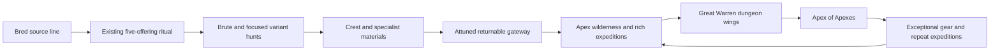

# Apex expansion — hunting grounds and the Apex of Apexes

**Design proposal, 2026-10-24. No new Apex type, flight behavior, dimension,
combat mechanic, item or loot table is implemented by this planning batch.**
The accompanying runtime change gives station/inspection menus a vanilla
container background. [APEX_SPECS.md](APEX_SPECS.md) describes the existing boss.
This document is the implementation direction for the user's next Apex work;
it does not claim the future content is available in a world.

## The intended power curve

The Apex is intended as a boss relative to vanilla midgame equipment and an
ordinary enemy relative to vanilla endgame equipment. Further player testing
sets the planned baseline to **1.6× current outgoing damage (+60%), with health
unchanged**. This supersedes the initial current-damage target; it is not yet
implemented. Keep that gear-relative relationship.
The user has fought several current Apexes with endgame gear; that play evidence
sets the direction. The expansion should not quietly turn every variant into a
much stronger boss, or reduce the dimension to avoiding one enemy at a time.
Infused juices, a prepared fighting line and future dimensional equipment make
larger mixed packs an attractive challenge. The true mod endgame is beyond them.

| Stage | What the player wants | Intended encounter |
|---|---|---|
| First ritual | Test a bred line and win its trophy | One Apex at the revised damage baseline; a meaningful vanilla-midgame boss |
| Variant hunts | Learn a different fight, obtain its material | The same strength band, with a different combat role |
| First dimensional expedition | Fight several Apexes, bring home conspicuous treasure | Vanilla-endgame gear is viable; mod preparation gives an advantage |
| Established expeditions | Choose routes, fight mixed packs, collect specialist rewards | Apexes are the dimension's normal hostile population |
| Grand dungeon | Bring a combat/juice build into a sustained expedition | Elite pack arrangements, rich wings and the Apex of Apexes |
| Repeat dungeon runs | Master the fight and build exceptional equipment | Generous repeat rewards, with a distinct final-boss reward tier |

These are encounter targets, not equipment checks at a portal. A skilled player
can go early. Ordinary care, breeding and useful limited companions keep their
place; no dimension visit is required to maintain a home or learn a basic job.

The current `ApexRules` bounds document the shipped reference: health 180–720,
movement .25–.42, jump .4–.8, melee 8–15, awareness 24–64, scale 1.8, and inherited
armor/resistance additions. The revised plan multiplies outgoing attack damage
by 1.6 **after** the existing bounded damage calculation: melee becomes 12.8–24,
and stomp damage scales by the same factor. Do not clamp the increased result
back to the old 15-damage ceiling. Health remains 180–720; movement, armor,
resistance, attack timings and enrage multipliers are not increased by this edit.
Apply the same damage target to the variant prototypes, without automatically
increasing healing, minion health, summon counts or the final boss's proposed HP.
Power-10 blasts retain power/radius 10: scale victim damage separately rather than
raising explosion power. The caster's explicit backlash remains its stated health
cost, not an outgoing attack to amplify. Compare variants using the **same source specimen**,
including weak, typical, specialized and capped examples. Range, crowd control,
healing, minions and flight spend encounter power too; do not give each new role
all the Brute's offense plus free specialties and extra health. Prototype values
below are starting knobs, not measured balance results.

## How an expedition should feel

**The first hunt.** I recognize my line in the boss, build a fighting space and
choose when to summon. A new focus changes the kind of Apex rather than hiding
a different difficulty tier. A huge mouth laser is visible before it fires; my
shield, cover, bow or movement is a real choice. A successful hunt gives a
recognizable trophy and a material with an understandable use.

**The first crossing.** The gateway opens onto a small sheltered arrival area,
with a working route home. Outside it I can see several large bunnidogs moving
through giant roots. They are ordinary inhabitants here. I fight a pair, spot
a flying threat over the next ridge, and choose whether my remaining supplies
justify a richer ruin. The return portal never asks for another rare offering.

**Learning the packs.** A Brute and a beam attacker suggest cover and flanking.
A Broodcaller makes me decide between clearing the swarm or rushing its source.
A support Apex healing a wounded Blastmaw makes target priority immediately
matter. I can bait the large blast, use terrain to break a drain, or have my
trained companions pressure the support while I reposition. Visual behavior
teaches those decisions; an entry manual does not.

**Coming home richer.** Even an ordinary expedition produces useful bulk
materials and role-specific crafting progress. A good ruin can supply enough
wealth to change a base project, alongside an exciting sample, seed or weapon
component. A major treasure room should feel extravagant, not like a chest of
several low-value items after a long fight.

**The dungeon attempt.** I choose two wings, bank what I can, then decide whether
to commit to the central arena. On a failed boss attempt, the route back still
exists. On a win, I receive a substantial reward bundle and a clear choice of
powerful upgrades. Repeat runs are worthwhile without making the first victory
or a carefully bred companion disposable.

## The five combat roles

Names other than the existing Apex are working names. Ground and flying versions
exist in the plan for **all five roles**, including the current Brute. A role must
be recognizable through its pose, silhouette accents, attack sound and windup,
not only through coat color or a nameplate.

| Role | Signature | Main response | What it gives up |
|---|---|---|---|
| Existing Apex, the Brute | Warned pounce/stomp and melee pressure | Dodge its commitment; punish recovery | Sustained range and ally support |
| Prismmaw | Large mouth-fired beam | Break line of sight or move across its limited tracking | Strong pursuit during a beam; Brute pounce/stomp |
| Broodcaller | Calls enraged bunnidogs to swarm | Clear the finite pack or interrupt/kill its caller | Much of its direct burst and time spent casting |
| Blastmaw | Repeated, enormous self-damaging explosions | Recognize the radius, escape or use solid cover | Its own health and a long exposed recovery |
| Lifebinder | Hook, brief stun, armor-ignoring drain and healing | Evade/block the hook, break the ray, prioritize support | Heavy direct damage and unlimited healing |

### Brute: preserve the baseline

Keep `bunnidogs:apex`, the existing ritual and its source-bearing Crest working.
Implement the planned +60% outgoing damage without adding health.
Its pounce/stomp warning, half-health enrage and bounded genetics are the comparison
point. Do not retroactively upgrade old saved bosses into one of the new roles.
The flying Brute later exchanges continuous ground pursuit for dives and recovery
landings; it is not a hovering melee hitbox with permanent perfect access.

### Prismmaw: the mouth laser

The mouth opens, a bright core gathers and an identifiable charging sound rises.
A visible aiming line precedes a thick beam. During the damaging channel the Apex
turns slowly; it cannot snap the ray onto a dodging player every tick. Solid
cover blocks it. Afterward the mouth dims and the creature has a punishable pause.

Initial prototype: 1.25–1.75 seconds of warning, about 1–1.5 seconds of channel,
range around 32 blocks, and two or three scheduled damage pulses. Start around
9.6–12.8 raw damage per pulse (the original 6–8 prototype ×1.6) and a cast-wide damage ceiling, then compare actual
survivability with the current Apex. This beam uses ordinary armor/shield damage
rules; the Lifebinder owns the special armor-bypassing role. Large visuals need
not mean a screen-wide invisible collision cylinder.

A player crossing the line can be hit, but neither every rendered particle nor
every server tick is a new damage application. Raycast the current unobstructed
segment, record who each pulse hit, and respect native hurt/cancellation behavior.
The effect begins at a shared, body-relative mouth position. Source genetics may
change the body, so the server ray and client mouth effect must agree.

### Broodcaller: a finite enraged swarm

The caller plants itself, beats its forefeet and gives a rising call. Several
small enraged bunnidogs emerge on real nearby ground and pursue the encounter's
targets. They visually belong to its source line. They are dangerous helpers,
not additional full-health Apexes.

Start with four minions per call, a maximum of six alive per caller and a shared
local encounter cap of twelve. Initial minion candidates: 6–10 health, 3.2–4.8 melee
damage (the original 2–3 prototype ×1.6), 30–45 seconds of life, and at least twelve seconds between calls. These
numbers are a playtest starting point. A caller cannot accumulate an army while
its target is behind an unloaded wall or keep summoning off-screen forever.

Killing the caller promptly ends its temporary pack, with a short visible fade.
A cancelled/blocked spawn spends no phantom slot. Minions cannot breed, be tamed,
be captured into a permanent lineage, or drop normal genetic/legendary materials,
Crests or XP. Existing ordinary bunnidogs are never silently converted into these
minions. A dedicated hostile minion identity carries its owner and expiry.

### Blastmaw: an actual large explosion, more than once

The target behavior is comparable to a `minecraft:fireball` with
`ExplosionPower:10b`, **not a small explosion with a large particle effect**.
Use native power-10 exposure, damage and knockback semantics for victims. Actual
26.2 API behavior must be checked during implementation. Point-blank contact can
be lethal even with excellent equipment; this is a spatial attack to avoid.

Before detonating, the belly/mouth visibly swells and flashes for roughly
2.5–3 seconds, with an expanding ground warning and a distinctive fuse sound.
Movement slows and commits before impact. Aim for a 12–16-second recovery, giving
players time to punish the creature rather than fight a constant chain of blasts.
The native power value has a large affected area; a nominal distance is not a
promise of uniform damage through cover. Solid terrain and explosion exposure
must matter, and warnings need to remain visible without relying on color alone.

**Friendly-fire contract:** every other member of the Apex family receives zero
blast damage, blast knockback and ignition from this attack, across ground and
flying types. Its temporary allied swarm is protected as well. Ordinary player
companions remain vulnerable; give a short visible party-danger cue rather than
making them secretly immune. Do not implement family immunity by canceling every
explosion, protecting players, or checking only the original `Apex` Java class.

**Repeatable self-cost:** suppress the caster's native point-blank blast damage,
then apply one explicit backlash of about 15% of maximum health. Its own blast
leaves at least one health. It cannot arm again below the health needed to pay
another backlash plus a small margin. It can still fight, be finished by players,
or be healed by a support. This permits repeated explosions without an immortal
one-health detonator or immediate creeper-style death. No backlash on a cancelled
cast; a valid blast pays once even when it hits no player.

**Terrain policy:** preserve the current ritual's non-destructive Overworld play.
Power-10 victim effects remain; block destruction is enabled only in designated
dimensional wilderness, under mob-griefing and actual server protection hooks.
Do not damage protected builds, portals, encounter anchors or critical dungeon
structure. Dungeon breakable cover is an explicit separate policy. Do not scan
or generate unloaded chunks to complete an explosion; postpone the cast when its
required loaded area is unavailable. Limit simultaneous detonations locally,
without quietly lowering the explosion power.

### Lifebinder: hook, stun, drain and shared vitality

A bright tether grows from the mouth/forelimb before a physical hook projectile
launches. The hook can miss, strike cover or be blocked from the front. A hit
pulls a player a bounded distance over several ticks, respecting collision;
it never teleports through a wall, mounts the player on an entity or drags them
into an unloaded chunk. Prototype reach: about 20 blocks, pull at most eight.

The impact gives a short **movement stun**, initially .4–.6 seconds. The player
keeps aim, shielding and item use. A per-player recovery window shared across
Lifebinders prevents chain stuns; start with eight seconds. The drain has its own
brief visible start, so the hook is an advantage rather than an unavoidable
hook-to-death script. Missed hooks leave a real recovery opening.

The draining mouth ray **bypasses armor and toughness**. It does not automatically
bypass Resistance, absorption, protection enchantments, shields, Totems, damage
cancellation or death rules. Break line of sight, leave the tether's reach or
interrupt its channel to end it. Prototype: a two-second channel with four pulses
of 1.6–3.2 raw damage (the original 1–2 prototype ×1.6); tune against actual vanilla-endgame protection, not the size
of the visual ray. Only this role has the armor-bypassing ray by default.

Actual accepted health/absorption loss supplies a single healing budget. A
cancelled hit, immune target or fully blocked pulse gives no healing. Divide
that budget between the caster and a chosen nearby ally; do not multiply it by
the number of allies. A small starting vitality reserve, initially 8–12 health,
allows some support before the first successful drain. Total healing is bounded,
starts around two health/second, and cannot exceed any recipient's maximum.

Combat recipients are other hostile Apexes and their enraged pack minions.
Ordinary wild bunnidogs can receive ambient care outside combat; player-owned
companions are not automatically enrolled in an enemy support network. Supports
do not drain each other, cattle or their own minions for infinite healing.
Blastmaw self-cost cannot become free vitality income. The visible ally tether
makes target priority readable: pressure the healer or break its supply.

## Flying versions and mixed packs

Flight is a movement variation of every role, not a second stat multiplier.
Prismmaw can strafe before committing its mouth beam; a flying Broodcaller lands
or calls minions onto checked ground; a flying Blastmaw warns, descends and
commits its detonation position; a Lifebinder exposes itself while tethering.
The flying Brute dives, then recovers within reach. Flight is readable through
added silhouette details and movement, while preserving the approved face/body.

Initial constraints: use local altitude bands roughly 4–10 blocks above valid
terrain, bounded pursuit and periodic vulnerable low passes/landings. Do not
hover forever beyond a sword user's reach, attack from terrain-hidden positions,
or turn flying Blastmaws into unannounced overhead bombs. Bow/crossbow access is
valuable; a melee player still has openings. Confined dungeon versions get
geometry suited to their actual collision size and flight needs.

Start with small mixed groups, then test combinations deliberately:

| Pack | Interesting decision | Coordination constraint |
|---|---|---|
| Brute + Prismmaw | Draw the Brute around cover, then punish the beam | Beam warning remains visible during the pounce |
| Broodcaller + Brute | Clear adds or attack the caller while the Brute pursues | Shared live-minion cap |
| Blastmaw + Lifebinder | Break healing and bait an expensive detonation | One main displacement/detonation commitment at a time |
| Flying Prismmaw + ground Brute | Alternate ranged openings and ground pressure | Aerial attacker must expose accessible firing lanes |
| Broodcaller + Lifebinder | Stop replacement/healing of the finite pack | No healing loop or extra reward from summoned minions |
| Three-role dungeon group | Pick a target priority using space and party roles | Bounded hooks, one recovery window, readable major tells |

No role grants allies permanent new stats simply by being present. Supports have
finite throughput; calls have live caps; casters commit to visible actions.
Multiple players and companions can divide pressure. Shared stun recovery is
per victim, so several supports cannot take turns removing all player agency.
Do not solve hard combinations by doubling every enemy's health.

## The dimension: the Great Warren

Working name: **the Great Warren**, a whole realm shaped by enormous burrows,
roots and guava growth. Its landscapes should make a player want to explore,
build an outpost and fight for treasure, rather than resemble a featureless boss
arena. The Apexes are its usual dangerous fauna. Calm pockets and ordinary
bunnidog traces keep the world recognizably related to the rest of the mod.

Suggested first biome set:

| Region | Look and travel | Encounters and reward character |
|---|---|---|
| Crownroot Groves | Giant pale roots, amber fruit, broad sheltered paths | Brute/Prismmaw packs; sample caches and abundant workshop stock |
| Glassbloom Flats | Reflective mineral growth and long sight lines, with solid cover islands | Beam and flying threats; lenses, crystals and rich ore pockets |
| Thunder Hollows | Huge excavated basins, scorched ridges and expendable rock cover | Blastmaws; volatile hearts, exposed riches and dangerous shortcuts |
| Chorus Thickets | Living nest columns, low tunnels and movement through branching roots | Broodcallers; brood materials, seed hoards and lost breeding records |
| Heartroot Reaches | Hanging roots, luminous pools and bridges around deep solid-floored ravines | Lifebinders and aerial packs; support materials and high-value ruins |

Start with a smaller excellent region set if production scope demands it, but
keep the terrain roles distinct. Existing worldgen must not be silently replaced.
Use a new namespaced dimension with its own generation, biome spawn rules,
structures and loot. Existing Overworld warrens keep their current scale/tone.

### Getting in, coming back and making a foothold

Proposed access: construct a recognizable frame/anchor using crying obsidian,
copper and Ender materials, then attune it by **showing** a real Apex Crest.
Keep the Crest and its source record as a trophy. A crafted resonant eye pays
for the initial activation; it is not charged on every crossing. The first
successful ritual therefore connects breeding to exploration without consuming
a beloved lineage record. Exact recipe tuning belongs to implementation.

Do not require a hidden quest flag, an Ender Dragon kill, a full armor inspection
or a new manual. Recipe unlocks, the anchor's visible sockets and the Crest's
optional tooltip communicate the connection. The existing Apex ritual remains
available independently, and a skilled player can choose an early expedition.

A new arrival creates a small collision-checked refuge and a return anchor before
placing the player. No Apex may spawn inside that immediate arrival space. Store
the actual source dimension/position, support multiple players and never route
people to another player's arbitrary entry. No forced chunk search for a distant
landing; validate candidates within explicit bounds. The return path must work
without carrying another consumable, including after death or an interrupted
connection. A blocked landing chooses a nearby safe point without deleting builds.

An established player can light/build a local base, place a recognizable ward
anchor, or retreat into real fortifications. A ward suppresses **new natural
spawns** in a small loaded area; it does not erase living enemies, repel attacks
for free, suppress the entire biome or switch off dungeon encounters. Make it
materially worth building an outpost. Normal inventory, death and item-recovery
rules remain; no surprise inventory wipe, forced reset or compulsory grave system.

### Population and traversal

Apexes should make up roughly 70–90% of the dimension's hostile spawn choices.
Aim for repeated visible groups of two to four, with three to six active threats
being an ordinary prepared encounter. Announced hotspot packs can be larger;
initially test eight to twelve including adds in spacious, deliberate locations.
These are local composition targets under the native monster cap, not a separate
unbounded spawn loop or a density promise for every viewpoint.

Place rich sites along routes with alternating visibility, shelter and combat
spaces. Let players spot threats before committing, flank a pack, fly over some
terrain, dig a shortcut or create cover. Aerial encounters make elytra valuable
without pretending players cannot use it. They should not invalidate all flight
with global anti-elytra effects. Retreat beyond a bounded pursuit ends that fight;
no cross-dimension revenge tracking or permanently loaded pursuing packs.

Critical distinction: **ritual Apexes stay persistent, named boss encounters;
wild dimensional Apexes behave as ordinary hostile mobs**. Wild ones use normal
loaded-area spawning/despawning, do not all create boss bars and do not retain
players' chunks. Dungeon elites/bosses have explicit local persistence. Arrival,
monster caps, minion lifetime and ability effects need multiplayer/server evidence
before describing the dimension as performant.

## Loot worth the danger

The realm is meant to have **crazy loot**. Do not interpret that as a cosmetic
Crest and a few emeralds. Its ordinary enemies pay for repeated expeditions;
ruins can noticeably improve a base economy; the grand dungeon contains powerful
new equipment, extraordinary genetic finds and a genuinely lavish final vault.
The separation below makes each activity worthwhile rather than reducing rewards.

| Source | Reliable reward | Exciting additional reward |
|---|---|---|
| Ordinary wild Apex | Its role's reagent, useful bulk stock and XP | Rare intact source Crest or specialist component |
| Mixed-pack den / elite | Several role reagents and a real cache | Focus component, high-quality seed or remarkable recorded specimen |
| Large ruin | Considerable vanilla wealth, mod supplies and building materials | Gear component, archived lineage or a special decorative set |
| Dungeon wing | A unique key and a generous wing cache | Role equipment or a premium upgrade material |
| Apex of Apexes | Guaranteed core reward, trophy and final-vault haul | Additional exceptional gear/genetic finds; worthwhile rematch rewards |

### Reagents lead to recognizable equipment

Working item concepts, not implemented recipes or registered IDs:

- **Prism Lens → Prism Lance.** A charged mouth-beam-inspired ranged weapon,
  strong against a line of enemies. Its windup, cell supply and exposed firing
  commitment distinguish it from a bow. The lens also has an optical/research use,
  so collecting one is useful to a breeder as well as a fighter.
- **Chorus Heart → Lineage Standard.** A portable or placed rally tool that helps
  an actual bonded combat party hold a position or coordinate a push. It improves
  real trained companions instead of generating an endless army or granting
  unlearned intelligent jobs. A later spirit-pack variant can share the same
  strict temporary-summon/no-loot rules as enemy minions.
- **Volatile Heart → Cataclysm equipment.** A spectacular charged siege attack or
  explosive weapon whose real blast costs reagent/charge and has a visible arming
  time. Pair it with blast-oriented armor/utility choices. The dimension's enormous
  blasts should produce loot with an equally recognizable use; terrain permissions
  still apply to player tools and automation.
- **Heart Spool → Tether Gauntlet / Vitality Conduit.** A powerful hook or combat
  drain that can support allies, fueled by actual accepted hostile damage.
  No infinite vitality from friendly pets, self-damage, armor stands or cancelled
  hits. Healing and mobility are worthwhile endgame choices, not only more melee DPS.
- **Aerial Membrane → Apex Wing Harness.** A strong flight-oriented chest item
  with a climbing burst and meaningful aerial control. Keep a clear equipment
  tradeoff with dedicated armor/elytra, and a bounded resource/cooldown for its
  strongest burst. Do not introduce an undeclared mandatory accessories dependency.
- **Sovereign Core → exceptional upgrades.** The final boss material improves one
  chosen weapon/armor/party-support branch. Multiple branches make rematches
  desirable. It is not consumed just to keep a portal open or maintain a base.

Juices remain useful consumables on their existing effect/quality rules. Aerial
movement, resistance, recovery and an effective combat party create preparation
choices. New fuel/cell recipes should use actual materials and preserve bottle
remainders, without rerolling frozen infusion genetics or inventing free quality.

### Treasure should look generous when the chest opens

Initial treasure-budget proposals for substantial sites, to tune in actual play:

- A rich ruin can include 16–32 diamonds, 2–6 netherite ingots, 2–4 enchanted
  golden apples, a substantial stack of advanced mod reagents and valuable blocks,
  **plus** a specialist/genetic find. Do not make every item roll mutually exclusive.
- A major dungeon wing adds its role component, premium workshop/juice supplies
  and a meaningful equipment or lineage roll. Supply chests along the route let
  players recover some food/arrows/materials without erasing expedition planning.
- The final vault targets at least a stack of diamonds, several netherite ingots
  or occasional netherite blocks, enchanted apples, premium essences, a guaranteed
  Sovereign Core reward and a choice-bearing exceptional item/upgrade. A trophy
  is additional recognition, not a substitute for useful treasure.

The economic consequence is intentional: successful mod-endgame expeditions can
replace some vanilla resource grinding. Keep those generous material yields when tuning recipes and drop weights. Keep the most distinctive
cores/gear in the dungeon so a stationary basic-mob farm does not replace its
combat and exploration, while ordinary kills still have worthwhile reagents.

Genetic treasure can include complete reusable Tissue records, unusual compatible
body/mind combinations, and genuinely high-quality seeds (candidate quality
20–33). Freeze the actual rolled record/seed when its loot is created; reopening
a chest or moving a sample must not reroll it. Specialist bred stats and hidden
copies make a find exciting without making every seed perfect at every task.
Preserve the current eleven-pair genome and personal-learning distinction:
a valuable mind is potential, not a free finished civilization.

Crests and archives keep the source line's identity. Natural basic enemies use
a distinct reward profile: routine role loot with a rare full Crest, rather than
a mandatory unstackable full Crest on every kill. The original ritual retains
its guaranteed player-credited Crest and established first-victory advancement.
Summoned swarms never become reagent, legendary, XP or Crest farms.

## The great dungeon and the Apex of Apexes

Working dungeon: **the Crown Warren**. Giant roots and breeding halls descend
around a central chamber, with three distinct wings and visible connections back
to a safe staging area. Aim for a substantial expedition rather than a sequence
of identical spawner boxes. Branching routes, vantage points, real cover, caches
and a few optional dangerous shortcuts give building, ranged and party play uses.

A candidate structure has three wings: the Glass Gallery (beam/flight lanes),
the Brood Vaults (swarm/control spaces), and the Heart Furnace (support/blast
combinations). Completing any two supplies actual keystones to the central gate.
The third remains an optional rich route. Sockets show the keys physically;
opening the gate persists. Mining useful shortcuts is allowed, while the critical
anchor/door/return machinery is protected from enemy blasts. Do not require a
written quest log or make a missed optional chest block all progression.

### The Crowned Apex

The **Apex of Apexes**, working name *the Crowned Apex*, is a distinct boss above
the ordinary Apex power band. A large recognizable bunnidog carries five visible
resonant crests/organs, showing the roles that feed its attack pattern. It has
its own entity/encounter design; do not inflate every wild Apex's stats to make
this fight seem special. Its trophy records the actual encounter identity.

| Phase | Boss behavior | Player opening |
|---|---|---|
| The Hunt | Large pounces and deliberately aimed mouth beams | Punish the committed landing/beam recovery and use cover |
| The Living Crown | Calls a bounded mixed pack; uses visible vitality links | Pressure support/caller targets or break links while retaining boss damage access |
| The Broken Crown | Alternates flight/dive and huge warned detonations, with exposed recovery | Reposition into the advertised safe lane, ground it and commit damage during recovery |

Each phase highlights a limited combination. An attack director allows at most
one boss-scale major attack and one add-scale major attack to overlap; it cannot
combine a fresh unavoidable hook/stun with a point-blank detonation. Phase
transitions clear obsolete hooks, damage rays and summons. Only short transitions
are invulnerable; adds should not create an indefinite full-health shield.

Candidate arena: roughly 80–96 blocks across with genuine height and a flying
ceiling, several cover routes, visible impact warnings and space to escape a
power-10 blast. Test the actual scaled hitbox and movement. Critical structure
survives; selected cover can break and later regrow/reappear as a boss mechanism,
with visible timing. Every mandatory pattern has a viable route without a
particular rare loot item. Elytra, a bow, potions/juices, blocks and companions
all help rather than being disabled to force one strategy.

Prototype health budget: about 2,400–3,600 solo, **subject to actual mod-geared
combat**, with an initial first-success pacing target around 6–9 minutes and
faster 3–6-minute practiced runs. Health alone is not the fight. Scale additional
players sublinearly, freeze the scaling roster at engagement, and avoid healing
from players entering/leaving. Design the initial multiplayer case for two to
four players and put an explicit bound on larger-party scaling/effect counts.

The arena has a readable retreat/return route. When all valid participants leave
or die, stop abandoned effects, clean up temporary adds and reset the encounter
after a deliberate grace period. Do not follow people home, erase dropped items
or immediately start a replacement fight during recovery. Store encounter/loot
completion so reloads cannot duplicate a victory or skip a paid rematch.

The first victory supplies a displayable unique trophy, the generous vault and
a guaranteed core entitlement for actual participating players. Include meaningful
damage and genuine support contributions; an idle visitor is not an unlimited
reward generator. Subsequent victories remain rewarding through further upgrade
branches, materials and genetic finds. Rematches spend a clear set of realm
reagents at the arena, use the established native spawn/payment revalidation,
and do not require rebuilding the original five-legend ritual every time.

## Obtaining variants before the dimension exists

Implement the fights before natural dimensional spawning. Keep the existing
unfocused ritual exactly usable for the Brute. A craftable **ritual sigil** names
one of the other roles; a feather-based recipe produces its flying version later.
Use recognizable ingredients (for example amethyst for a beam, gunpowder for a
blast, and a ghast tear for support), without requiring loot obtainable only
from that unimplemented fight. Exact recipes are an implementation decision.

The player uses the actual sigil on the Crucible with the chosen Tissue Sample
in the other hand. The preview shows those exact resources, role, movement type
and existing five offerings. On success it pays one sigil and the existing costs;
cancelled or changed attempts pay nothing. No first-inventory-match sigil choice,
hidden automatic variant roll or extra instruction screen. The normal source-only
route keeps its behavior. Recipes and a concise purposeful tooltip are sufficient
entry points; detailed role descriptions belong in optional reference.

This provides a testable Survival path for each new type while leaving the future
portal, dimension and dungeon unimplemented until their own milestones.

## Connections to the rest of the mod

Breeding supplies the source line for focused hunts and an actual fighting party.
Body adaptations, bred combat strengths and complementary learned skills make
preparation personal. Archive loot gives breeders new combinations to work with,
while an ordinary limited-minded bunnidog can remain useful at home. No loot
item needs to overwrite its mind or invalidate the old eleven-pair records.

Juicers, high-quality seeds and preserved infusions supply expedition preparation.
Inventories, bundles, shelters and real return routes support long trips. A home
outpost can eventually support loaded-area jobs under the existing intelligence
plan; receiving an ancient tool/blueprint does not instantly implement autonomous
civilization. That integration is later work, not a dependency for the fights.

Companions can participate subject to normal combat danger and revival rules.
Give parties visible rally/retreat cues and collision-safe gateway access; do not
ban pets to simplify boss targeting or make protected companions immune to every
attack. An expedition can also succeed solo. Wealth, unusual building materials
and trophies should visibly enrich the player's home afterward.

## Implementation architecture and compatibility

### Shared family, explicit origin, preserved saves

- Preserve `bunnidogs:apex` as the current ground Brute and keep old saves,
  Crests, Tissue/Seed/Genome strings, source points and ritual costs valid.
- Extract shared hostile/genetic/boss behavior behind an `ApexBase` or equivalent
  family contract. The current `Apex` is final; new sibling types require a real
  refactor. It is not enough to register different skins with the same goal list.
- Prefer distinct entity registrations for each role/movement combination, sharing
  rules and renderer code. That gives ten combinations including the existing ID,
  and makes spawn/loot tags explicit. Do not duplicate every goal for each type.
- Store explicit origin: ritual, wild, dungeon, temporary minion. Old entities
  missing this metadata default to **ritual**, preserving persistence/rewards.
  Moving a ritual boss into the dimension does not convert it to a despawning mob.
- Role/flight metadata for new trophies is optional and separate from the current
  Tissue payload. Old Crests keep working as ground-Brute records. Item metadata
  does not grant authoritative spawn origin or a better reward profile.
- Keep full source genomes (seven body and four mind pairs) intact. Existing
  Apex combat uses body traits and bred stats; this proposal adds no twelfth
  gene, new hereditary combat power or automatic learned profession. Body shape
  and adaptations still matter. Valuable mind samples enrich ordinary breeding.
- Current `Apex` inherits `Bunnidog`, whose tick invokes trail/combat/learning
  controllers even though home care is gated. Audit those guards before large
  wild packs; profile actual hostile tick cost instead of assuming mesh reuse
  makes all companion infrastructure free. Preserve ordinary companion behavior.

The code audit found class-specific family checks in `ApexRitual` (nearby boss
refusal), `Apex.registerGoals` (retaliation), and `BunnidogDrops` (special rewards).
Generalize them deliberately. When wild mobs arrive, the ritual boss lock should
track persistent encounters rather than let ordinary nearby fauna monopolize it.
Family blast immunity must cover every new type,
without making all ordinary bunnidogs Apexes. Existing client renderer and
attribute registration in `BunnidogsClient`/`ModEntities` must cover new types.

### Server-owned attack lifecycle

Use a common lifecycle: acquire an eligible target → warn → commit → resolve
bounded pulses/impact → recover. Every exit (death, unload, invalid target,
Peaceful, phase reset) cleans up transient work. Save bounded remaining recovery;
loading an in-progress cast cancels its uncommitted effect and retains recovery,
rather than replaying a hit or starting from zero cooldown.

The server validates target, reach, collision, loaded bounds, native permissions
and damage results. Client effects communicate a cast ID, role, start/phase and
bounded geometry. Derive animation locally between updates; no per-frame custom
packet for every laser particle. Ordinary wild Apexes have no boss bar; only real
ritual/elite/boss encounters enroll tracked viewers in one.

- **Beam:** use checked unobstructed segments and a bounded affected-entity query.
  Pulse identity prevents duplicate damage. Particle density and sound falloff are
  capped per observer; graphics settings can reduce effects without removing tells.
- **Blast:** inspect the actual 26.2 explosion/event APIs before implementation.
  Filter family victims before damage **and knockback**, with cast provenance.
  Do not heal allies afterward or make Apexes immune to unrelated player blasts.
  Backlash is a distinct exactly-once cost. Terrain policy is separate from entity
  damage; respect mob-griefing, claim cancellation and unloaded-world boundaries.
- **Support:** register an explicit damage type that bypasses armor, not every
  protection tag. Healing comes from accepted damage/absorption loss, capped to
  the actual pulse budget. A bounded status effect and shared per-victim recovery
  handle stun; no client-only movement lock or forced inventory/aim suppression.
- **Summons:** owner/encounter identity, expiry and bounded live counts survive
  relevant saves. Spawn callbacks may cancel or alter candidates. Never search
  every loaded entity each tick or produce a replacement wave during cleanup.
- **Flight:** select actual flying navigation/control and altitude/collision
  rules. Ground goals cannot simultaneously own movement. Windup hovering, dives,
  landing recovery, scale changes and portal transfers must be validated together.

### Dimension and dungeon engineering

Use new namespaced dimension/type, biome, density/noise settings, structures,
spawn rules and loot resources; do not overwrite vanilla terrain. Data-driven
loot/spawn tags expose deliberate customization. Native MONSTER categorization
already exists for the current Apex; wild persistence/despawn behavior still
needs explicit handling rather than inheriting its current persistent boss setup.

Structure pieces own their chunk intersections. Generated signs and block
entities use the already-fixed detached `WorldGenRegion` initialization path.
A live `ServerLevel` test alone cannot establish worldgen safety. Portals create
checked arrivals and store paired endpoints; dungeon anchors own local encounter
state. Use bounded loaded queries and explicit template extents, not a global
entity manager or forced loading of the whole dungeon.

Separate reward profiles for ritual, wild, dungeon and temporary summons.
Generate exact genetic records once. Respect native player kill credit, mob-loot
rules, cancellation, full inventories and real item remainders. Do not alter old
crests or retroactively reroll already generated chests. Dungeon participation
and completion are authoritative and saved, preventing reconnect/reload farming
without turning ordinary repeat expeditions into one-time content.

English and neutral Peruvian Spanish ship together at each implementation step.
Role names, death messages, effects, focused previews and loot descriptions use
normal Components; saved IDs/records remain language independent. Preserve the
current no-tutorial-HUD rule. New silhouettes/effects require the approved art
pipeline and actual client review; none are generated in this planning batch.

## Staged delivery and evidence

| Stage | Reviewable result | Evidence appropriate to that change |
|---|---|---|
| AX1 — family + Prismmaw | Preserve old ritual/saves, introduce focused ground beam hunt | Existing ritual/crest cases plus actual warned ray, cover and damage case; client beam alignment |
| AX2 — Broodcaller | Finite hostile swarm with source/expiry and useful reward | Cancelled spawn, live cap, caster death and no-minion-loot case; mixed-pack play |
| AX3 — Blastmaw | Real repeated power-10 detonation and family protection | Native explosion on a sufficiently large loaded fixture; cross-type immunity, backlash, terrain/protection refusal; client tell |
| AX4 — Lifebinder | Physical hook, bounded stun, true drain and actual healing | Miss/cover/collision, two-caster anti-chain, armor bypass, cancelled damage and healing-conservation case; solo/coop play |
| AX5 — flight | Flying Brute and all four role variants | Collision, altitude, landing and each role's cast positions; melee/ranged access in actual terrain |
| AX6 — Great Warren | Returnable portal, natural Apex ecology and first rich ruins/gear | Real generation-stage and endpoint/save cases; loaded population/performance and endgame expeditions |
| AX7 — Crown Warren | Branching wings, Crowned Apex, core upgrades and lavish vault | Real bounded encounter/reset/reward cases, generation safety and full solo/coop dungeon play |

The next requested Apex implementation should start at **AX1**, not by shipping
an empty dimension, all ten placeholder entities or a final boss without its
supporting fights. Keep each type playable in Survival through its focused ritual.
Build out the other types before flight/population, then the realm and true finale.
Observed bugs/UI corrections still take priority when the user reports them.

Verification stays proportional: reuse the existing build/native suite, add
meaningful type-specific cases and run model checks for real mesh/effect/renderer
changes. A power-10 explosion needs a declared fixture large enough to contain
its actual queries; the old eight-block empty structure is insufficient. Do not
pad progress with thousands of duplicate math assertions or repeatedly rerun the
whole suite after documentation-only edits.

Balance acceptance requires actual play: current-equivalent specimens against
midgame and enchanted vanilla-endgame kits, then the same fights with useful
juices/companions, and mixed packs of two/four/six. Test airborne and grounded
versions, multiplayer support chains, retreat and visibility at ordinary settings.
Headless native tests establish mechanics and conservation, **not** encounter
feel. Keep numerical knobs configurable/data-driven where useful, and tune from
those observations without abandoning the revised +60%-damage, unchanged-health common-Apex target or
the realm's deliberately generous loot.
