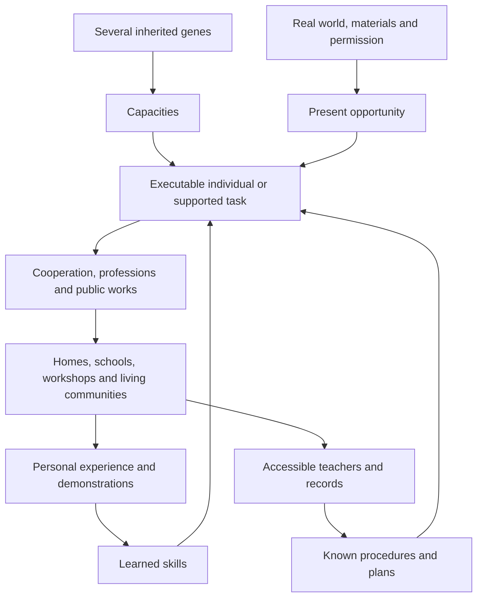

# Intelligence, learning and living civilizations

> Latest implemented progression: [HEARTH_PROGRESSION_SPECS.md](HEARTH_PROGRESSION_SPECS.md)
> supersedes the old offering/entry rules and adds a focused sustainable household,
> resident teaching and paid construction. Broader civilization stages remain open.
>
> Current continuation: [COURIER_CULTURE_SPECS.md](COURIER_CULTURE_SPECS.md)
> implements real courier apprenticeship and physical route records, without
> granting skill from books. [COMPLETION_AUDIT.md](COMPLETION_AUDIT.md) records
> the accepted gap priorities. General planning/professions remain unfinished.

Design direction, 2026-10-21, originally planned against `0c92ded`.
**I1 and initial I2 are now implemented**: full cognitive genetics, migration,
mind inspection/forecasts and attended practical learning. Actual behavior and
its limits are in [COGNITION_SPECS.md](COGNITION_SPECS.md). The professions,
culture and autonomous civilizations below remain future work. Numerical
examples are starting hypotheses, not measured balance. The delivery sequence is in
[INTELLIGENCE_ENGINEERING.md](INTELLIGENCE_ENGINEERING.md); playable acceptance
stories are in [INTELLIGENCE_SCENARIOS.md](INTELLIGENCE_SCENARIOS.md).

## What the user is asking for

Intelligence must be inherited through several genes. Its range must be large:
some bunnidogs cannot perform many of today's sophisticated behaviors, while
others can learn professions, organize their own communities and build a real
civilization without a player supplying every decision. This should enrich the
whole mod, including animals that never become citizens. This message plans the
update; it does not authorize implementing it during this turn.

The proposed direction is a spectrum of **different minds**, with increasingly
powerful combinations. Memory, problem solving, practical manipulation and
communication are distinct. A gifted individual is consequential, but a town
also needs tools, knowledge, food, safe land and other residents. It cannot be
summoned by breeding one special allele or reaching a population counter.

Keep the existing cohesion principle: players discover abilities through care,
work, demonstrations and visible results. A long manual, hidden IQ formula or
spreadsheet must not be necessary to enjoy an animal or understand a stalled town.

## The experience worth building

I bring home a little bunnidog that recognizes me and loves following its family,
but cannot understand my supply route. I still like it. It can wear a pack,
provide useful inherited materials and eventually help with a simple local job.
Its limitations are stated honestly; repeating the same command does not fix them.

Another remembers where I showed it to put carrots. I demonstrate once, give it
access to the right stores, and see it repeat the job. Its offspring may inherit
the capacity, but do not hatch knowing my chest coordinates or wearing its title.

Later, a planner notices the nursery is crowded. It proposes another sleeping
room. A skilled builder understands the plan, a courier brings actual planks,
and a less sophisticated helper carries a marked load. They build a useful,
walkable room, furnish it, move in and maintain it. Removing the planner does
not erase the carpenter's hands or the plan already laid out on the worksite.

In the wild, I find a small community doing this for itself. It has food growers,
a teacher, stores, a repair crew and remembered relationships with neighboring
communities. I can trade, contribute, learn, invite a traveller or simply watch.
It can make progress without my permission clicks, and it can struggle for
concrete reasons without becoming a world-destroying nuisance.

## A source-grounded starting point

| Current system at `0c92ded` | Implication for this update |
| --- | --- |
| Seven physical/behavioral genes, two four-bit allele IDs each, occupy 56 bits of `Genome.packed`. | Four cognitive genes require a real multiword genome design. Appending them to the current shift loop corrupts data. |
| Five bred stats control physical performance, perception, growth and some work eligibility. | Senses is perception, not intelligence. Bloom is growth/recovery, not a sixth hidden brain stat. |
| Expressed body alleles use dominance; hidden copies matter for inheritance. | Preserve those rules. Cognitive dosage needs its own explicit display and inheritance model. |
| Garden, supply, food, home, trail and combat behaviors use separate native Goals and shared readiness/recovery rules. | Add a capability and intent layer, then reuse proven actions. Adding more competing Goals will not create coherent planning. |
| Adults already carry bundles; residents harvest, gather, replant, compost and tend Cradles when qualified. | Explain exactly which tasks become learned or genetically limited. Equipping a pack is different from understanding a delivery job. |
| Combat has three deliberately recruited fighters, reliable recall and recoverable bonded defeat. | Cognitive tactics may deepen this, but basic rescue and an understood recall remain dependable. |
| Breeding drops an actual litter seed; crops/Cradles hatch it. | Autonomous reproduction must pay for, plant, tend and hatch real seeds too. No population-manager spawning. |
| Settlements have authored trees, houses, tunnels, farms and landmarks, at worldgen levels 1–5. | They are physical layouts, not existing simulated governments. Tree count is not cognitive or cultural advancement. |
| Stations have actual inventories, root transactions, power states and protection checks. | A profession operates those inventories; it cannot produce virtual stock in parallel. |
| Samples, books, names, parent links, bottles and baskets all carry saved identity/genetics. | The expanded genotype must survive every one of these paths. Knowledge and town membership must not accidentally become DNA. |
| English and shared Spanish are now maintained together. | New capabilities, teaching, professions and settlement feedback need both languages from their first playable slice. |

Relevant implementation anchors: `genetics/Genome.java`, `Gene.java`,
`Founders.java`, `Stats.java`, `Seed.java`; `entity/Bunnidog.java`,
`GardenGoal.java`, `HomeRoutes.java`, `TroughSupply.java`, `CompanionCombat.java`,
`CompanionParty.java`; `layout/Settlement.java`, `TunnelShape.java`,
`TableSheet.java`; and the existing care/workshop block entities. Historical
specifications may describe older checkpoints; source and `START_HERE.md` take
precedence when implementing.

## Four things that must stay separate

| Layer | What it determines | Where it lives |
| --- | --- | --- |
| Genetic capacity | Which kinds of tasks the animal can understand, retain, execute and coordinate | Full inherited genotype; visible from a sample or pup |
| Individual learning | Known routines, practiced skills, familiar places, recognized signals | This animal's saved learning state |
| Shared culture | Demonstrated procedures, plans, signs, records, institutions, local customs | Actual residents and accessible community records |
| Present opportunity | Health, rest, food, tools, permission, stock, reachable work and safety | Current world and task state |

A brain is not an all-access work permit. A clever pup cannot operate a forge.
A gifted adult cannot know an undiscovered recipe, use another player's chest,
materialize tools or finish work in unloaded chunks. A practiced gardener with
modest abstract reasoning may outperform a brilliant newcomer at familiar work.

The interface should distinguish **can learn**, **has learned**, and **can do now**.
For example: “Can learn delivery. Show a destination.” / “Knows this route.
Destination full.” / “Can carry a marked load with a guide; cannot run a route.”
This distinction also prevents players spending hours training an impossible job.

## Proposed cognitive genetics

Add four diploid cognitive loci, with internal IDs separate from the existing
seven body-locus IDs. Working player names and Spanish equivalents:

| Locus | Main capacity | Examples of what it changes |
| --- | --- | --- |
| Memory / Memoria | Retaining routines, landmarks, distinctions and longer sequences | Remember a store, repeat a route, keep a plan across interruptions, retain a demonstrated craft |
| Reasoning / Razonamiento | Relating causes, anticipating dependencies and choosing alternatives | Notice missing ingredients, choose another food patch, sequence a room, propose a shared project |
| Handling / Destreza | Learned motor control and purposeful manipulation | Sort rather than dump, use a tool, place a supported block, make a fitted component |
| Communication / Comunicación | Understanding, conveying and representing shared instructions | Follow a work signal, demonstrate, coordinate a handoff, teach, use a public plan or trade agreement |

These are gameplay traits, not a human IQ simulation. The lowest band still has
animal recognition, instinct, attachment and a sense of home. Low Memory does
not mean forgetting its keeper each minute; high Communication does not mean
being friendly to everyone. Keep labels concrete and affectionate.

The recommendation is to add cognitive loci rather than infer everything from
Ears, Coat or temperament. Reusing only the current seven slots would avoid a
schema migration, but would couple intelligence to appearance/ecology and make
certain existing physical lines universally preferable. New loci let a small,
feral, short-eared animal be an inventive builder without rewriting those body
traits. Perception and personality remain important collaborators.

### More than four independent switches

Each allele contributes a small vector of capacities, with a primary effect and
sometimes a smaller secondary effect. Both copies contribute: cognitive alleles
use **dosage/codominance**, explicitly unlike body-gene dominance. A mixed pair
can express an intermediate or complementary mind rather than hiding one copy.

An initial model is a primary contribution from the mean of a locus's two
alleles, plus modest cross-locus contributions, kept within a bounded range with
plain qualitative descriptions. For example, a demonstrative communication
allele may slightly improve retention of observed routines; a spatial reasoning allele may support practical
construction. An animal can reach a useful combination through different crosses.
Exact weights belong in one pure table, not scattered Goal predicates.

Illustrative allele directions, not finalized saved tables:

| Locus | Possible common directions | Higher/specialist directions |
| --- | --- | --- |
| Memory | immediate, familiar, route-minded | archival; stores longer procedures but needs working rest |
| Reasoning | reactive, associative, spatial | inventive; considers dependencies and bounded novel combinations |
| Handling | mouth-led, practical, precise | constructive; joins tool use with spatial understanding |
| Communication | self-directed, responsive, demonstrative | symbolic; shares plans and recorded procedures |

Do not make one “genius” mutation grant all four capacities. Do not require a
mutation-exclusive allele for civilization. Common and regional material should
be sufficient through selective crossing. Rare variants can make unusual
specialists, change teaching style or offer an efficient combination; they should
not be a compulsory key.

Regional founder pools can favor interesting combinations without making any
habitat the universally superior mind: route memory at coasts, spatial handling
in mountain dens, attention to signals in caves, material/routine memory in
meadow communities. Every habitat retains broad variation. These are fictional
animal/ecology differences, not a ranking of real peoples or cultures.

### Capacity is not a single unlock ladder

Use specific predicates involving several capacities. The following 0–4 figures
are **prototype examples**, useful for designing forecasts and edge cases:

| Task | Example genetic requirement | Also needs |
| --- | --- | --- |
| Recognize family/home, eat, seek basic safety, accept care | Instinctive floor for every animal | Actual reachable food/shelter where relevant |
| Understood bond/return signal | Simple association available across the spectrum | Established bond and familiar signal; no random refusal |
| Repeat one demonstrated local harvest | Memory 1.5, Handling 1, modest association | Adult, demonstration, suitable plant and existing work conditions |
| Selectively replant/tend | Memory 2, Reasoning 1.5, Handling 1.5 | Practice, ingredients, plant compatibility and existing Bloom threshold |
| Deliver between known stores | Memory 2, Reasoning 1, Communication 1 | Demonstrated route, storage authorization, safe path, carrying capacity |
| Assist a builder from a marked short instruction | Memory 1.5, Handling 2 | Accessible plan, qualified supervisor, material and one bounded action |
| Build a familiar small structure independently | Memory 2.5, Reasoning 2.5, Handling 2.5 | Learned plan, valid site, tools/materials |
| Teach a concrete routine | Memory 2, Communication 2 | Knows it, a receptive pupil and a real demonstration |
| Teach an abstract plan or coordinate a crew | Memory 3, Reasoning 2.5, Communication 3 | Proven skill, shared reference and reachable participants |
| Propose/sequence public works | Memory 3, Reasoning 3, Communication 2.5 | Knowledge, observed need, resources and a permitted site |

Not every citizen must satisfy the planner row. A planner can have poor Handling;
a fine craftsperson can have modest Communication. A town is a working combination
of individuals, not its average IQ. Physical traits still matter: neither a smart
small animal nor its cultural status makes it carry four bundles.

A supervisor can translate a complex plan into a simpler supported task. This
lowers the subordinate's **instruction complexity**, not its physical or genetic
execution requirements. It cannot teach a mouth-led animal precision joinery,
magically raise its heritable ceiling or direct it from an unloaded district.

### Costs and reasons to keep different animals

More sophisticated sustained work requires longer useful rest, learning time,
access to suitable meals and reliable shared knowledge. Physical genomes still
supply hauling, mobility, perception, defense and environmental survival.

Avoid “smart animals randomly disobey” or “all geniuses become neurotic” as balance.
Clear costs are better: one architect is productive only with a crew, materials
and somewhere to build. An immediately useful, low-maintenance familiar worker
can be a good choice even when more advanced individuals exist.

The top end should be powerful. A flourishing town should genuinely save work,
provide goods and solve local problems. Do not erase that reward by scaling every
job's requirement to its best resident. Likewise, do not add a universal daily
hunger chore just to penalize the player for owning a clever pet.

## The low end: real limitations without broken pets

New low-capability animals lose access to complex autonomous behaviors they all
perform today. The limitation should be predictable and visible, not a slow task
that appears to work forever.

| Existing behavior | Instinctive / limited mind | Familiar or trained mind | Advanced combination |
| --- | --- | --- | --- |
| Food, healing, ordinary reproduction, local home recognition | Retained | Retained | Retained; can organize communal support |
| Wearing and retrieving a bundle | Retained; player manages contents/destination | Can carry a demonstrated route | Can sort, schedule and hand off authorized supplies |
| Bond, heard emergency return, basic combat instinct | Retained; fewer contextual orders/tactics | Can learn ordinary Follow/Wait/Assist routines | Can coordinate positions and sensible handoffs |
| Crop/loose-food work | May eat/forage locally; cannot understand a mixed work program | Repeats an understood task | Selects jobs and dependencies from local need |
| Replanting, composting, Cradle tending, supply mode | Unavailable without the corresponding capacities and routine | Learned specialty; existing stat/resource gates still apply | Coordinates a functioning farm/nursery network |
| Bell gathering | Local social response; no long scheduled route | Learns a bell/routine | Can give warnings or work signals |
| Mineral scouting | Can react to a sound/smell; no precise ore-family report | Learns a concrete cue if physical scout requirements fit | Remembers surveyed places and communicates a safe task |
| Building/crafting/trade | No independent profession | A few supervised or practiced tasks | Genuine planning, professions and civic participation |

Attachment and a safety return are foundational associations; they do not imply
comprehending “fill this store before supplying that one.” All temperaments remain
capable of bonding. A feral animal can be an excellent engineer; a loyal animal
can have very limited planning. Intelligence does not decide whose side it is on.

Previously trained adult partners and established work lines need an explicit
compatible migration, not a surprise loss of trusted behavior. The engineering
document recommends a heritable legacy helper profile, not an invisible permanent
exception flag. New founders can display the complete range from the outset.

## Learning by doing something legible

Use a small, bounded set of skill families: tending, hauling, making, building,
scouting, care, teaching and coordination. Avoid an XP bar for every recipe and a
thousand-tick-per-action grind. A first successful attended demonstration should
establish a simple routine; a few successful cycles can make it independent.
Complex skills require a suitable teacher or a discoverable experiment.

The animal retains what it actually learned: a task type, a constrained procedure,
familiar places and observed affordances. Moving a chest makes a route stale;
it does not erase hauling skill. A teacher's death can remove access to a rare
procedure, but does not erase every pupil's practiced routine.

A useful teaching interaction:

1. Open care and choose a purpose, or use the relevant worksite's Teach control.
2. The panel states whether the animal can learn it and what is missing.
3. Select a concrete source/destination or demonstrate one real action nearby.
4. The animal watches, tries an affordable step, and gets visible success/failure.
5. A short status becomes “Knows the orchard route” or “Needs a builder's plan.”

The player supplies actions or a few selections, not a programming language.
“Deliver carrots here” should not require writing a rule sheet. A later expert
routine editor can combine supported steps, with strict length and permission
bounds, but it is not a prerequisite for basic professions or autonomous towns.

Pups learn through play and observation near family: carrying a harmless twig,
following a short demonstration, tending alongside an adult. Skills are personal,
not inherited. High Bloom still gives faster maturation; growing quickly does
not permanently miss the learning window because adult instruction remains
available. Golden-dandelion growth pause is respected. No new forced old-age
death: an “elder” is an experienced resident, not a timer that kills a favorite.

## Professions that produce something real

Jobs are current work and learned competence, not immutable genetic castes.
A resident can change work as needs and interests change. A job title should be
earned by demonstrated competence, not granted by equipping a costume. The same
simple action can appear in several professions.

| Profession | Actual work | Genetic/physical combinations that matter |
| --- | --- | --- |
| Orchard keeper / farmer | Harvest, reserve seeds, replant, organize compatible beds | Retention + practical reasoning; Bloom for existing special tending |
| Forager / fisher | Find renewable local food, preserve roots/stock, bring it home | Memory + observation; Diet and shore/cave/desert traits |
| Hauler / storekeeper | Deliver, sort, maintain public reserves, supply authorized stations | Route memory + communication; Build capacity and terrain mobility |
| Woodworker / weaver | Process paid timber/fiber, make basic tools, caches and furnishings | Handling + learned sequences; material access |
| Digger / mason | Excavate permitted cells, shore passages, quarry surveyed material and shape/place it | Spatial reasoning + handling; strength is useful but never a substitute |
| Builder | Execute a valid plan and repair known structures | Handling + memory; reasoning for independent adaptation |
| Surveyor / architect | Assess terrain, preserve exits, plan expansion and allocate material | Reasoning + memory + enough communication to convey a plan |
| Nursery keeper / carer | Stock compatible meals, supervise safe hatching, tend pups and convalescents | Concrete retention + communication; Bloom retains its real role |
| Teacher / recorder | Demonstrate, retain procedures, make accessible shared records | Memory + communication; can teach only what it knows |
| Scout / messenger | Remember safe routes, report hazards/resources, carry real messages | Perception + memory + communication; Legs/Coat keep regional value |
| Watchkeeper / defender | Warn, escort and protect within actual hearing/territory | Existing temperament, genes and combat rules; communication adds coordination |
| Artisan / trader | Make real regional goods and exchange authorized surplus | Handling, memory and social understanding; actual stock |
| Steward | Prioritize communal needs, organize short crews and remember agreements | Reasoning + communication; depends on specialists rather than replacing them |

Start with grower, hauler and builder; keep the full roles as the end-state
planning target. Some jobs share a workstation. Do not introduce thirteen new
crafting blocks before the first real supply cycle works.

## A civilization that can arise on its own

### A complete independent bootstrap

A qualifying wild family chooses a safe site near renewable food and basic
materials. It can create a provisional den/cache, collect guavas, obtain simple
planting material, establish a small crop patch, make crude storage and tools,
build real Nests, and teach the short routines needed to support a litter.
The first permanent room should answer an actual need, such as another safe Nest.

The initial primitive action set must support this without a player, merchant,
metal tool or prebuilt full workshop: gathering native sticks/seeds/food, moving
loose material, scratching suitable soil by water, simple planting, processing
wood at a primitive work area and making a basic shelter/cache. Any new fiber or
primitive-material recipe must have an explicit renewable input; it is not a
number credited to a global resource pool. Avoid a recipe loop that requires an
iron tool before making the first thing that can acquire iron.

Existing natural supplies may accelerate a settlement but must be finite. A
prebuilt level-five warren can become a useful inhabited ruin; it is not evidence
that residents constructed it. A specific no-player bootstrap scenario must prove
a community builds and sustains something after its starting supplies run down.

### Institutions grow from demonstrated needs

These are observed states, not a level purchased with enough smart heads:

- **Household:** recognizable home, shared food, simple cooperation and family care.
- **Workshop community:** practiced workers, paid production, storage and repairs.
- **Commons:** communication, teaching, supported helpers, nursery and public plans.
- **Town:** redundant essential roles, archive, planned expansion, trade and local rules.
- **Network:** independently functioning communities connected by actual couriers,
  agreements, exchanged expertise and limited migration.

A small intelligent household can be culturally sophisticated while physically
small. A large inherited warren with low-capability residents may remain a lovely
animal colony. Static worldgen tree count keeps its existing meaning.

### Daily life and governance

At dawn, residents assess observed needs: meals and safety, unresolved repairs,
pups, stock, then improvements. Work alternates with rest, social time, teaching
and ordinary animal activity. Rain, thunderstorms, injury and lost paths visibly
change the schedule; do not invent vanilla seasons.

A few capable residents can propose projects, but essential knowledge and
responsibility should become redundant. Leaders are not an irreplaceable magic
building. An unfinished known plan can survive its author, and a practiced crew
can maintain a town that temporarily lacks an architect. When no one can plan or
teach new work, the town can plateau rather than collapse overnight.

Begin with a small set of local policies: essentials first, maintain a food
reserve, protect the nursery, repair safe routes, export only surplus, and build
inside permitted land. Advanced communities may vary those priorities and develop
recognizable customs. Show decisions through a readable worksite/commons panel:
“Building a nursery: 6 planks missing,” not pages of simulated political debate.

Residents should retain personality and preferences. Familiar partners, shared
work, rescue and teaching can create stable relationships. This can influence
which partner they teach or travel with, but it must not create an opaque approval
meter that makes routine work or recall fail without explanation.

### More than efficient production

Give communities a little life outside work: familiar sleeping groups, cooperative
play, apprentices copying a craft pattern, shared meals, a repaired public path
with a real commemorative marker, and distinct local rug/woodwork choices. Simple
animals already play and socialize; sophistication expands what they can share,
not whether they can be happy or affectionate.

A recorder can keep a small history grounded in actual events: who taught the
first builder, which crew finished the bridge, which storm forced a repair.
Use bounded event records and short translated templates with real names, not
fabricated AI memories or compulsory dialogue. The player can care about a place
and its residents after its supply output is no longer exciting.

### Population, meals and continuity

Healthy passive pets keep their existing no-starvation baseline. Extended skilled
work consumes real suitable meal/support resources and includes rest. Lack of
supplies pauses work and prompts foraging or reprioritization; it does not quietly
kill a keeper's unloaded animals. Exact work-meal rates need prototypes.

Communities breed only with housing, nursery capacity, compatible willing adults,
food surplus and room under configured population limits. Spend two actual
breeding guavas and create the normal litter seed. Plant or use a real Cradle,
then hatch onto a valid pad and care for the real pups. Swarm fertility must not
turn into unbounded entity production. A full nursery defers another litter.

Culture passes through time together, mentors and records. It is not copied into
the seed. A transported pup carries its inherited capacities and already learned
personal experiences, not its parents' job, the entire town archive or automatic
ownership of the next colony it meets.

Growth may stall, projects may be abandoned, and a community can scatter after a
real disaster. Avoid offline tragedies and arbitrary scripted decline. Visible
failure should leave understandable physical history: an unfinished annex,
an empty teaching place, a repaired flood wall, a road no longer used.

### Care and the value of experience

Bonded combat rescue already preserves valued individuals. Eventually extend the
same practical idea to registered civic residents through an explicit care design:
a trained carer needs safe access, actual first-aid food, a real empty transport
item when moving a downed animal, and a place for quiet recovery. No free healing
or remote rescue. This citizen-care extension belongs with living settlements;
it is not already supplied by the keeper-bound combat code. Environmental hazards
remain real, so archives and more than one experienced worker still matter.

### Architecture and regional identities

Keep bunnidogs recognizable: quadruped movement, paw/mouth work, crouched work
surfaces, low stores, wide short passages, sleeping circles and nursery hollows.
Do not turn intelligence into humanoid bodies, enlarged cartoon brains or human
villages with bunnidogs pasted into them. Preserve the approved creature anatomy.

Use modular rooms, roofs, thresholds, supports and path segments selected for
terrain, known technique and available materials. Plans must be walkable at each
usable stage. Initial live building should create a genuinely useful tiny annex;
large halls, bridges, roads, water works, workshops and districts are later goals.

Regional examples:

- Meadow orchard commons: woven storage, low timber workspaces, gardens and shared
  lunch clearings beneath guava trees.
- Tundra community: insulated den links, snow-surface messengers, wool production,
  sheltered stores and short exposed journeys.
- Desert family: shaded courtyards, cactus plots, saved food and reliable well
  approaches; no assumption that every cactus can be eaten by every resident.
- Swamp settlement: raised dry paths and mushroom beds; swimming ability does
  not remove air requirements or authorize unsafe domestic routes.
- Cave scholars: lit shared plans, mineral survey notes and memorable junction
  markings; hearing/scouting genes still supply actual sensory reach.
- Mountain builders: terraced approaches, supported ramps, short stonework spans
  and strong haulers. Goat legs help movement, not arbitrary cliff construction.
- Nether enclave: fire-safe materials, wart plots and carefully separated safe
  routes. One fireproof worker does not make its whole crew lava-proof.
- Island community: kelp beds, dry docks/shore stores, coastal routes and buoyant
  courier equipment only after actual water-route support exists.
- End settlement: supported enclosed walkways and chorus care. Defensive Phase
  remains a bounded escape, not a free inter-island building transport system.

Not every structure needs a new block. Reuse guava wood, existing Nests, Troughs,
Cradles, presses, signs, rugs and pedestals. A few new essentials—primitive public
cache/work area, public plan marker and records—can earn their place through
multiple jobs. Recipes and exact new block count remain implementation choices.

## How every existing loop becomes richer

| Existing loop | Enrichment | Boundary that preserves its purpose |
| --- | --- | --- |
| First encounter and care | Observe concrete limitations/talents; invite a learner; discover useful simple tasks | Basic affection, healing and a home are not intelligence unlocks |
| Exploration and wild lineages | Find complementary minds, cultures, working settlements and knowledgeable individuals | No one biome owns civilization; do not replace physical regional genes |
| Breeding, seeds, Mutagen | Cross several capacities toward a desired role; forecast combinations and actual pup potential | No inherited recipe, loyalty, town office or learned job; no guaranteed genius seed |
| Calipers, samples, books and Table | A readable mind profile, learnable roles, dosage pairs and job-focused forecasts | Samples describe potential, not the donor's whole education; no eleven-row squeeze into the old sheet |
| Registry and shows | Document a complete stable genotype and celebrate useful working lines/cultural accomplishments | Existing body shows remain worthwhile; no mandatory “highest IQ wins” competition |
| Gardening and food | Specialization, crop planning, seed reserves, delivery and actual support for workers | Existing Diet/Bloom/power/route/protection rules still apply |
| Nests, dens, weather and recovery | Nursery/clinic layouts, shelter repairs, room planning and communal care | No automatic seizure of player homes; keep safe return and actual recovery |
| Cargo and baskets | Meaningful couriers, remembered destinations, relocation and invitations | Whole contents/identity survive; transport does not teleport town stock or reset learning |
| Combat companions | Simple reliable partners through advanced remembered positions and team coordination | No random recall failures, compulsory genius fighter or automatic recruitment of citizens |
| Human Breeders, commissions and venues | Ask for actual apprentices, useful crews, deliveries, repairs and teaching outcomes | Human villager professions stay native; hereditary tests and learned-skill tests must be labeled separately |
| Workshop and crafting | Real operators, tool use, supply chains, repair and experiments | Operate actual machines/recipes; no second invisible production engine |
| Drops, grooming and juice | Ordinary lines remain useful; working towns create nonlethal goods and services | Intelligence is not a new premium brain-drop farm or knowledge-in-a-bottle exploit |
| Apex | Communities can warn, evacuate and organize recovery; advanced companions have purposeful roles | Residents never autonomously spend seeds/legends to summon it; boss changes need a later explicit design slice |
| Redstone and automation | Pause public work, inspect real stock/readiness, use logistics alongside hoppers | Power and protection remain authoritative; NPC work never bypasses them |
| Spanish and accessibility | Short localized capability/reason labels and optional detailed forecasts | No English-only programming UI or mandatory narrated manual |

Cognitive alleles need not each give a new potion effect. Keep existing effects
working and preserve the complete genotype in frozen infusions. If a later
focus/learning aid exists, it can support an eligible lesson; it cannot create
heritable intelligence or upload a town's skills to a player/animal.

## Living alongside the player

Three useful relationships should coexist:

- **Companions:** familiar individual bonds, adventures, household work and player
  instructions. A future citizen may still be the player's favorite travelling
  partner; “civilized” must not make old rescue/care interactions disappear.
- **Player-supported community:** the player marks permitted land/storage and
  chooses broad priorities. Residents organize actual work; the player can build,
  teach, trade, join expeditions or leave them to it.
- **Independent community:** inhabitants choose projects inside their wilderness
  reserve, manage stores/education and negotiate exchanges. The player is a
  visitor or ally, not an automatic owner of every found civilization.

A civic worker should not abandon its nursery because any visitor holds a guava.
Treats, work meals, courting and an invitation have distinct meanings once an
animal participates in a community. Ordinary pet/breeding interactions retain
their simple route; a citizen's panel makes its present responsibilities and
available deliberate interactions clear.

Interaction with a civic resident should say whether it is available, already
responsible for work, or willing to travel. Recommend an explicit invitation and
residency handoff for an independent citizen, rather than a surprise universal
capture ban or quietly deleting its town responsibilities. Existing keeper bonds
and protected animals retain their owner rules. Rescue always has a clear route.

NPCs do not take arbitrary player chest contents or mine “natural-looking” player
buildings. New wilderness communities get a recorded, bounded reserve at creation;
old settlements require deliberate activation/adoption for live construction.
Player edits inside a reserve become obstacles unless explicitly released to the
project. Claim integrations and mob-griefing restrictions apply to every edit.
These are conditions for trustworthy autonomy, not a permission dialog before
every plank.

A town should offer things a breeding farm cannot: a regional craft tradition,
a mentor for a specialized learner, a safe replenishment stop, a local survey,
help with a public bridge, or a real courier connection. The player should have
reasons to visit after finding its best founder.

## Discovery and feedback without a manual

Use one visible question at a time: “What can this one learn?” “What is this job
waiting for?” “Why is the community building this?”

Care shows a short mind description and useful learned work. Calipers reveal the
four capacities and genetic contributions. A worksite shows current action,
inputs, reservations and one blocking reason. A community center shows residents,
essentials, current projects and knowledge availability. Advanced breeding maths
stay in the Table; public work does not require reading them.

Examples of sufficient feedback:

- “Learns short routines. Show it a nearby task.”
- “Can carry this load; cannot remember a delivery route.”
- “Knows this job. Needs a safe dry path.”
- “Can build from a plan. A planner must mark the room.”
- “Nursery delayed: one more Nest and 4 breeding guavas needed.”
- “Repair first: the south passage has lost its floor.”
- “No teacher knows this process. Bring a record or invite an experienced worker.”

Use recognizable actions, brief barks/gestures, held objects and worksite markers.
Avoid constant thought bubbles, automatic chat spam, English dialogue novels and
icons for dozens of hidden meters. Learning/communication animations must retain
the current creature's body and be tested separately from headless behavior.

## Failure, challenge and payoff

Good challenges include matching a pupil to a mentor, developing a missing kind
of mind, choosing a suitable site, giving a crew materials without starving its
nursery, restoring lost knowledge, organizing an escort, and crossing physical
lineages to support a regional profession.

Bad challenges include repeating a command until an obedience roll passes,
feeding ten identical treats to unlock affection, waiting indefinitely for an
incapable animal to improve, following a 100-step guide, or repairing the same
NPC-dug damage every morning.

Do not make every settlement sprint toward the same city template. A fishing
household, a skilled workshop and a small community of teachers are valid ends.
Some players will breed champions, some keep limited pets, some study wild
cultures, and some sponsor an ambitious town. The update succeeds when all of
those play styles gain something real.

## Scope and delivery direction

Plan the full ambition, but implement complete observable journeys in order:
compatible hereditary capacity → honest basic limitations and learning → real
professions → small paid construction → independent local planning → cultural
continuity and demographic support → functioning wild settlement → inter-town life.
The engineering plan defines completion evidence for each stage.

Do not claim a civilization after adding a profession menu, faster work timers,
a new house template or an instant settlement upgrade. The decisive proof is a
community using actual inherited capabilities, learning, materials and actions to
create and maintain a useful way of life without continuous player orders.
